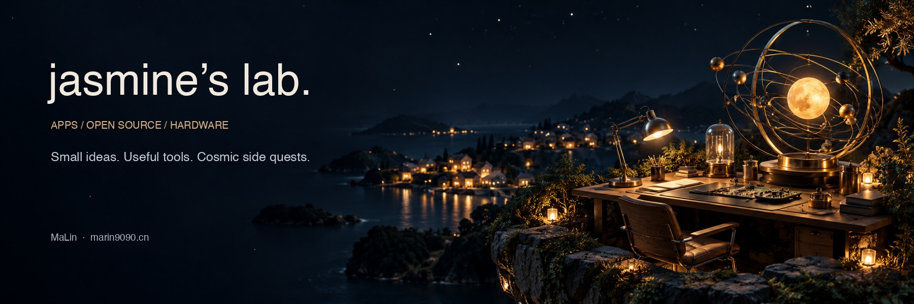
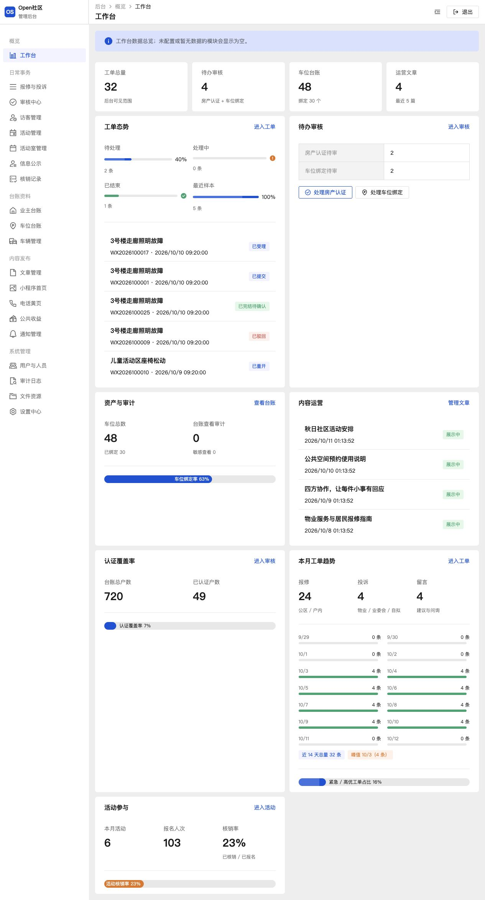

[](https://www.marin9090.cn/)

# Hey, I'm jasmine. 你好，我是 MaLin。

**I turn small everyday frictions into tools worth using.**<br>
把日常里值得改进的小事，做成真正能用的工具。

I build native apps, web experiences, AI tools, and things with circuit boards. I like the whole journey: from the first sketch to the empty state, the failure, and the last pixel of padding.

Creator of **[Tide · 不居](https://tide.marin9090.cn/)** and **[Open社区](https://github.com/jasmine889966/openshequ)** · Contributor to **[OpenWorker](https://github.com/andrewyng/openworker)**

[Website](https://www.marin9090.cn/) · [Journal](https://www.marin9090.cn/blog/) · [Email](mailto:marin9090@foxmail.com) · [Upstream PRs](https://github.com/andrewyng/openworker/pulls?q=is%3Apr+author%3Ajasmine889966)

## Things I'm building

### Open社区 · Better tools for everyday community life

**让社区里的事，有处可办，有迹可循。**

An MIT-licensed community platform: WeChat Mini Program, Vue admin console, and Express / TypeScript backend. Repairs, venue bookings, activities, and public notices connect residents with the people who keep a neighborhood running.

`WeChat Mini Program` `Vue` `TypeScript` `Express` `MongoDB` `MIT`

[Product website](https://www.openshequ.com/) · [Source & setup](https://github.com/jasmine889966/openshequ)

[](https://github.com/jasmine889966/openshequ)

*Product demo with fictional business data. Deployments require your own configuration and services.*

### Tide · Time, with a little more meaning

An iOS app for countdowns, elapsed time, subscription renewals, and habits. A collection of time cards for the moments that matter, with native interactions, local storage, and optional iCloud sync.

`Swift` `SwiftUI` `SwiftData` `WidgetKit` `ActivityKit` `CloudKit`

[Explore the app](https://tide.marin9090.cn/) · [App Store](https://apps.apple.com/app/id6777127402) · [TestFlight](https://testflight.apple.com/join/HV4ZBrjR)

### DeepSeek Monitor · Keep an eye on the tokens

A native macOS menu bar and desktop app for DeepSeek balance, token usage, costs, service status, and local alerts. For the part of the experiment where you wonder where the tokens went.

`Swift` `SwiftUI` `AppKit` `Swift Charts` `macOS`

[Source, screenshots & documentation](https://github.com/jasmine889966/DeepSeekMonitor)

### My corner of the universe · A website with side quests

A personal website that grew planets, satellite imagery, orbital views, custom shaders, and interactive worlds. Three.js is a dangerous thing to give someone who was only going to make a landing page.

`TypeScript` `Three.js` `GLSL` `Vite` `Typecho`

[Enter the site](https://www.marin9090.cn/) · [Explore Earth](https://www.marin9090.cn/explore/earth/) · [Moonlit City](https://www.marin9090.cn/explore/moonlit-city/?world=classic)

## Open source, with the sleeves rolled up

I contribute to **[OpenWorker](https://github.com/andrewyng/openworker)**, especially the details that make multilingual AI tools feel natural to use.

| Merged upstream | What changed | Merged on |
| --- | --- | --- |
| [#652 · Session titles in the user's language](https://github.com/andrewyng/openworker/pull/652) | Auto-generated titles follow the opening message's language, with natural brevity across languages. | 2026-10-17 |
| [#127 · English & Simplified Chinese GUI](https://github.com/andrewyng/openworker/pull/127) | Introduced the GUI localization foundation and language switching. | 2026-08-29 |

Two merged PRs, one continuing thread: let the tool speak the user's language. Other submitted work includes approval intent, connectors, and model compatibility; [each PR tracks its own current status](https://github.com/andrewyng/openworker/pulls?q=is%3Apr+author%3Ajasmine889966).

## Between the code and the workbench

| Area | What I work with |
| --- | --- |
| Apple apps | Swift, SwiftUI, UIKit / AppKit, SwiftData, CloudKit, WidgetKit, ActivityKit, App Intents |
| Web & Mini Programs | TypeScript, Vue, React, Next.js, Vite, TDesign, Tailwind CSS, WeChat Mini Programs |
| AI & automation | Python, LLM APIs, agents, MCP clients & servers, tool permissions, browser automation |
| Backend & data | FastAPI, Node.js, Express, PHP, REST, WebSockets, MySQL, MongoDB, SQLite |
| Desktop | Tauri / Rust, Wails / Go, Qt / QML / C++ |
| Graphics & design | Three.js, WebGL, GLSL, Blender / Python, Figma, Affinity Designer, draw.io |
| Hardware & UAVs | ESP32, ESP-IDF, Arduino, BLE, I2C, e-paper, KiCad, ArduPilot, MAVLink, QGroundControl |
| Testing & delivery | XCTest, Swift Testing, pytest, Vitest, Playwright, Git, CMake, Nginx |

I enjoy the point where code turns into something you can see or touch: a native interaction, an e-paper display, flight telemetry, or a CAD assembly brought to life in Blender.

Away from the editor: space and sci-fi, music libraries and NAS tinkering, home automation, 3D printing, and interactive worlds that were supposed to be tiny experiments.

```text
jasmine@lab:~$ cat interests.conf
interfaces   = thoughtful motion, useful tools, one last pixel of padding
intelligence = agents that reach tools and finish something useful
hardware     = circuits, e-paper, UAVs, real-world feedback
worlds       = space, shaders, one more hidden scene
exit_plan    = finish this project, then relax
known_issue  = the next project already exists
```

## How this lab runs

- **Build the whole journey.** The happy path, the empty state, the failure, and the way back.
- **Keep control visible.** Clear permissions, understandable tool approvals, and local storage where it makes sense.
- **Test what matters.** Real interactions, meaningful edge cases, and a result you can actually use.
- **Keep the curiosity.** There's usually another board to try or a small inconvenience to turn into a project.

---

**Got an interesting bug, a strange little device, or a side project that got out of hand?**<br>
[Say hello](mailto:marin9090@foxmail.com). We'll probably have something to talk about.

*Exploring the universe. Creating with code.*
